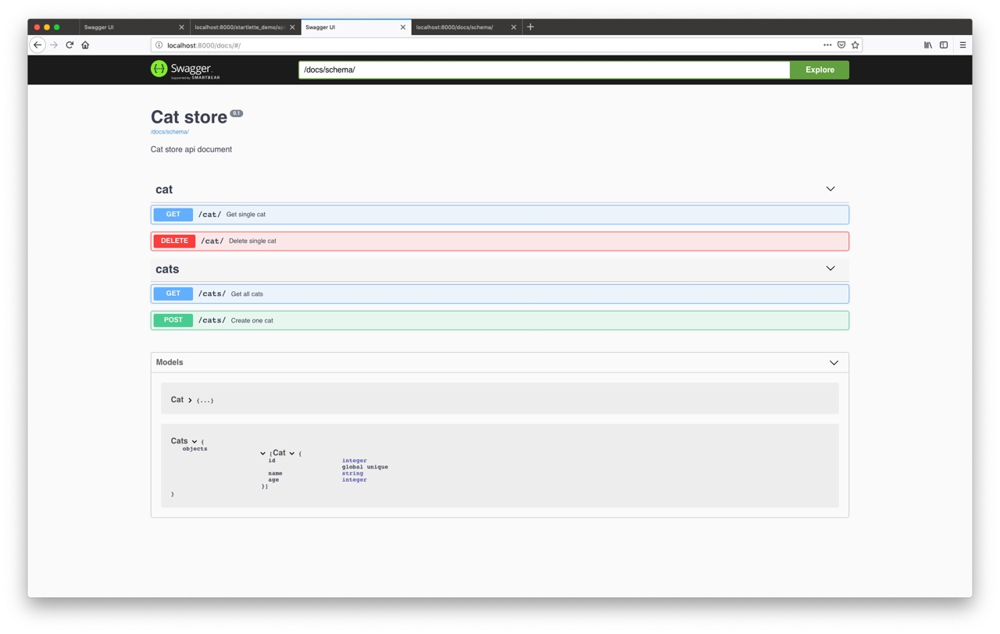

# APIMAN

APIMAN connects OpenAPI documentation and runtime request validation to existing Python web applications.

## What it provides

- OpenAPI 2.0, 3.0.x, and 3.1.x specification collection and validation
- Swagger UI, ReDoc, and raw specification endpoints
- Starlette, Flask, Django, Bottle, Tornado, and Falcon adapters
- Documentation loaded from Python docstrings, YAML, dictionaries, or files
- Request validation powered by `jsonschema-rs`
- JSON, XML, form, query, header, cookie, and path input support

## Default endpoints

| Endpoint | Purpose |
|---|---|
| `/apiman/specification/` | Generated OpenAPI document |
| `/apiman/swagger/` | Swagger UI |
| `/apiman/redoc/` | ReDoc UI |

All three endpoints are configurable when constructing `Apiman`.

Swagger UI and ReDoc are served from pinned jsDelivr CDN versions by the default templates. Replace the templates if your deployment requires fully local browser assets or stricter CSP rules.

## Next steps

1. Follow [Getting Started](getting-started.md) for a minimal application.
2. Select your adapter in [Framework Integrations](frameworks.md).
3. Choose a documentation source in [Writing Specifications](specifications.md).
4. Enable schema checks with [Request Validation](request-validation.md).
